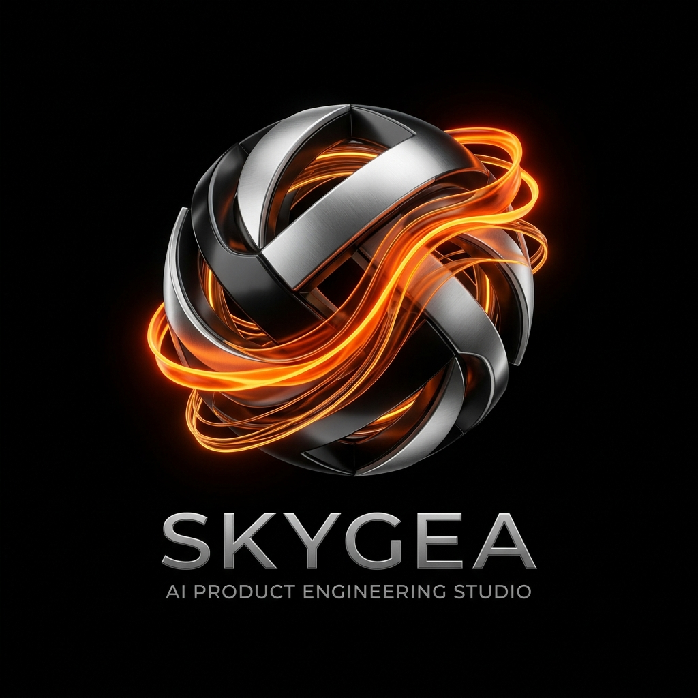

# Skygea — AI-Enabled Product Engineering Studio ⚡

> We architect and ship enterprise-grade, AI-enabled software in **8–10 weeks**, connecting innovative companies with world-class engineering talent.



---

## 🌌 Overview

**Skygea** is a modern, high-velocity AI product engineering studio inspired by elite agency standards. We partner with founders, growth-stage startups, and enterprise product teams to transform raw ideas into production-ready software using disciplined **agentic engineering workflows**.

### Core Services
1. **Product Engineering (`0.1`)**: Full-cycle AI architecture, multi-agent systems, RAG data pipelines, responsive UI, and cloud deployment in an accelerated 8–10 week sprint.
2. **Product Talent (`0.2`)**: Pre-vetted, top 1% global engineers and AI specialists embedded directly into your scrum team starting from **$30/hour**.
3. **Web Solutions & Systems (`0.3`)**: Ultra-fast web applications, design systems, and custom digital platforms engineered with dark glassmorphism and micro-interactions.

---

## 🎨 Visual Identity & Aesthetic

- **Theme**: Luxury Obsidian Black (`#050505`) & Hyper Electric Orange (`#ff5e00`, `#ff8800`) with warm amber glass accents.
- **Typography**: [Space Grotesk](https://fonts.google.com/specimen/Space+Grotesk) (display headings), [Inter](https://fonts.google.com/specimen/Inter) (body), and [JetBrains Mono](https://fonts.google.com/specimen/JetBrains+Mono) (code & data).
- **Architecture**: Zero-dependency, ultra-fast modular ES6 + Vanilla CSS3 with hardware-accelerated transforms and responsive layouts.

---

## 🚀 Quick Start (Local Development)

You can run the site with any local HTTP server:

### Using Python:
```bash
python -m http.server 4200
```
Then open `http://localhost:4200` in your browser.

### Using Node / npx:
```bash
npx serve .
```

---

## 📂 Project Structure

```
├── index.html                   # Main entry point & semantic structure
├── assets/
│   └── images/
│       ├── skygea-emblem.jpg    # 3D molten orange Skygea emblem
│       ├── work-aura-ai.jpg     # Aura AI Operations Telemetry case study
│       ├── work-synthetix.jpg   # Synthetix Autonomous Agent Studio mockup
│       └── work-pulse-bio.jpg   # Pulse BioTech Diagnostics platform mockup
├── css/
│   ├── variables.css            # Design tokens, color palette, gradients, shadows
│   ├── base.css                 # Reset, typography rules, baseline utilities
│   ├── components.css           # Buttons, glass cards, badges, stat counters, modal
│   ├── sections.css             # Hero, Marquee, Services, Manifesto, Work, FAQ, Footer
│   └── responsive.css           # Tablet and mobile adaptation rules
└── js/
    ├── main.js                  # Entry script initializing all modules
    └── modules/
        ├── navigation.js        # Sticky header blur, active link tracker, mobile menu
        ├── accordion.js         # FAQ accordion & expandable service drawers
        ├── counter.js           # Animated numbers counter via IntersectionObserver
        ├── modal.js             # Interactive Project Estimator & Discovery Call booking
        └── interactiveBg.js     # Ambient mouse-following glow light
```

---

## 🛡️ The Skygea Philosophy: *"AI-Enabled, Not Just AI"*

1. **AI Agents Draft**: Instant scaffolding, boilerplate generation, unit test coverage, and baseline schemas.
2. **Senior Engineers Architect**: Code reviews, security audits, database modeling, and latency optimization.
3. **Production QA**: Automated end-to-end testing, staging validation, and continuous deployment.

---

© 2026 Skygea LLC. All rights reserved.
